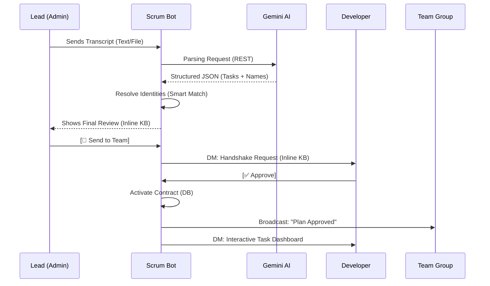

# 🏛 AI Scrum Master: System Architecture

This document outlines the core architecture, data flows, and design decisions of the AI Scrum Master bot, following the **Minimum Viable Architecture (MVA)** paradigm.

---

## 1. Core Philosophy

The system is built on four architectural pillars designed for high reliability and low maintenance:

*   **MVA (Minimum Viable Architecture):** Prioritizing robustness and speed of iteration over premature scaling.
*   **SQLite as SSOT:** A local SQLite database serves as the **Single Source of Truth**. All state transitions are persisted immediately to ensure consistency.
*   **Monolithic State Machine:** Avoiding complex microservices in favor of a robust, single-process state machine. This eliminates network latency between components and simplifies debugging.
*   **Logic Isolation:** LLM parsing (unstructured to structured) is strictly isolated from business logic (state transitions, database updates). The LLM proposes data; the repository validates and commits it.

---

## 2. System Data Flow (The Handshake)

The bot operates on a "Review & Approve" model to ensure 100% data accuracy before broadcasting to the team.

---

## 3. State Machine & Idempotency

### The Task Lifecycle
The system manages state through a strictly defined hierarchy of transitions:

1.  **DailyContract Status:** `draft` → `active` → `completed`.
2.  **Task Status:** `todo` → `in_progress` → (`done` | `blocked`).

### Idempotency (Safety First)
To prevent UI loops and database duplication, all state-changing operations are **idempotent**:
*   **Approval Handlers:** The "Approve" callback checks the current state. If a contract is already `active` (e.g., due to a double-click), the bot acknowledges the click but performs no further DB mutations, preventing duplicate notifications.
*   **Task Deduplication:** The `add_task` repository method uses a fuzzy normalization algorithm to compare incoming LLM suggestions with existing tasks. If a task with the same core description exists, it is skipped.

---

## 4. AI Ingestion & Persistent Backlog

### Persistent Backlog Logic
Unfinished work is never lost. The system handles carry-over via a two-stage process:
1.  **Database Migration:** The daily cleanup script (`discard_daily_plans`) identifies tasks that are NOT `done` or `blocked` from previous days and migrates them to the current date's contract.
2.  **LLM Context Injection:** These unresolved tasks are injected into the Gemini prompt as "Existing Unfinished Tasks." The LLM is instructed to merge these with any new tasks found in the transcript, preserving exact wording to maintain database integrity.

### The Delegation Rule
The LLM distinguishes between the *speaker* and the *assignee*. If a Lead says "Alexey, please fix the bug," the task is assigned to Alexey, not the speaker.

---

## 5. The "Smart Match" Algorithm

Identity resolution bridges the gap between spoken names in transcripts (unstructured) and Telegram IDs (structured). 

1.  **Normalization:** Both strings are stripped of whitespace and lowercased.
2.  **Cleaning:** Trailing punctuation (dots, colons, commas) added by LLMs are stripped using regex (`[\s:.,]+$`).
3.  **Hierarchy:**
    *   **Pass 1 (Alias):** Exact match in `user_aliases` table. Supports spaces and quotes.
    *   **Pass 2 (Full Name):** Case-insensitive substring match on the user's Telegram profile name.
    *   **Pass 3 (Username):** Case-insensitive substring match on the Telegram `@username`.

---

## 6. SLA & Performance Monitoring

The bot ensures team momentum via an **APScheduler** background service.

### 4-Hour Idle Monitor
*   **Trigger:** Runs every hour at `:00` during working hours (10:00–19:00).
*   **Reset Logic:** Any task marked as `done` updates the record's `updated_at` timer, resetting the 4-hour countdown.
*   **Timezone Correction:** Database timestamps are force-converted to UTC before comparison to prevent drift.

---

## 7. Testing Architecture (The Testing Pyramid)

We maintain system stability through a three-level testing strategy:

*   **Level 1: Database Operations:** Low-level tests using `aiosqlite` with an in-memory database to verify CRUD logic, foreign key constraints, and relationships.
*   **Level 2: Business Logic Idempotency:** State machine tests (e.g., `test_business_logic.py`) that mock Telegram callbacks to ensure transitions are safe, atomic, and idempotent.
*   **Level 3: LLM Mocking:** Integration tests for the parser (`test_llm_parser.py`) that use static transcript samples and mock Gemini API responses to verify extraction accuracy without incurring API costs or latency.

---

## 8. Deployment & Tech Stack

*   **Engine:** Python 3.13, Aiogram 3.15, SQLAlchemy 2.0.
*   **Database:** SQLite (local file) for simplicity and atomic persistence.
*   **Scheduling:** APScheduler for background SLA monitoring.
*   **AI Integration:** Google Gemini API (REST) with structured output parsing.
*   **Environment:** Containerized (Docker ready).
