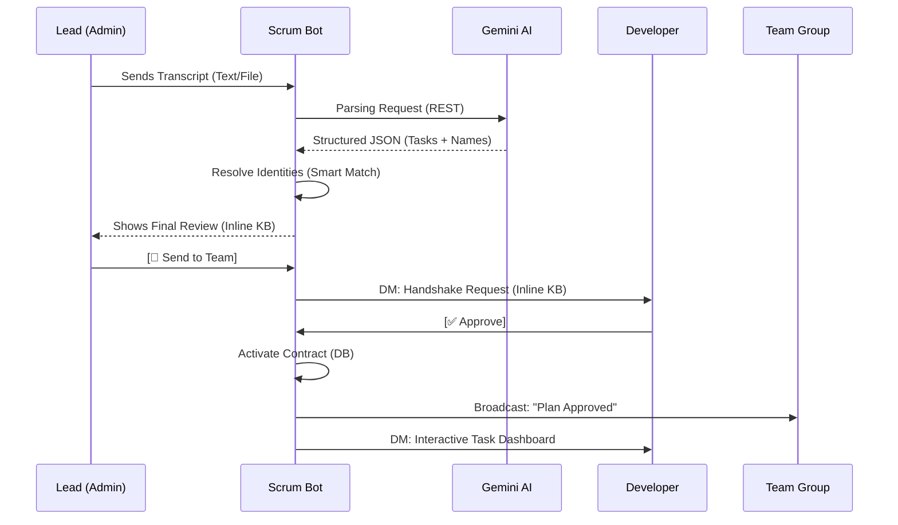

# 🏛 AI Scrum Master: System Architecture

This document outlines the core architecture, data flows, and design decisions of the AI Scrum Master bot.

---

## 1. System Data Flow (The Handshake)

The bot operates on a "Review & Approve" model to ensure 100% data accuracy before broadcasting to the team.

---

## 2. AI Ingestion & Reasoning

### Contextual Disambiguation
The bot handles complex team naming scenarios via the `INGESTION_SYSTEM` prompt. For example, in a team with two "Dmitrys":
*   **Дмитрий Б. (Process Lead):** Assigned when context involves coordination, ceremonies, or process.
*   **Дмитрий С. (Tech Director):** Assigned when context involves architecture, strategic logic, or deep technical implementation.

### The Delegation Rule
The LLM distinguishes between the *speaker* and the *assignee*. If a Lead says "Alexey, please fix the bug," the task is assigned to Alexey, not the speaker.

---

## 3. The "Smart Match" Algorithm

Identity resolution bridges the gap between spoken names in transcripts (unstructured) and Telegram IDs (structured). 

1.  **Normalization:** Both strings are stripped of whitespace and lowercased.
2.  **Cleaning:** Trailing punctuation (dots, colons, commas) often added by LLMs are stripped using regex (`[\s:.,]+$`).
3.  **Hierarchy:**
    *   **Pass 1 (Alias):** Exact match in `user_aliases` table. Supports spaces and quotes.
    *   **Pass 2 (Full Name):** Case-insensitive substring match on the user's Telegram profile name.
    *   **Pass 3 (Username):** Case-insensitive substring match on the Telegram `@username`.

---

## 4. SLA & Performance Monitoring

The bot ensures team momentum via an **APScheduler** background service.

### 4-Hour Idle Monitor
*   **Trigger:** Runs every hour at `:00` during working hours (10:00–19:00).
*   **Last Update Tracking:** The monitor uses the `started_at` timestamp (from approval) as the base.
*   **Reset Logic:** Any task marked as `done` updates the record's "last activity" timer, resetting the 4-hour countdown.
*   **The Nudge:** If a developer goes 4+ working hours without an update, the bot sends a friendly automated DM to check if they are stuck.

---

## 5. Database Schema (SQLAlchemy 2.0)

### Improved Tracking Fields
- `DailyContract.started_at`: Time of developer approval (timer start).
- `DailyContract.sla_ping_sent`: Boolean flag for the daily SLA nudge.
- `Task.updated_at`: Automatically tracked on every status change (timer reset).

---

## 6. Deployment & Tech Stack
- **Engine:** Python 3.13, Aiogram 3.15, SQLAlchemy 2.0, APScheduler.
- **AI Integration:** Google Gemini REST transport (optimized with `asyncio.to_thread` for stability).
- **Environment:** Containerized (Docker ready) with SQLite storage for simplicity.
